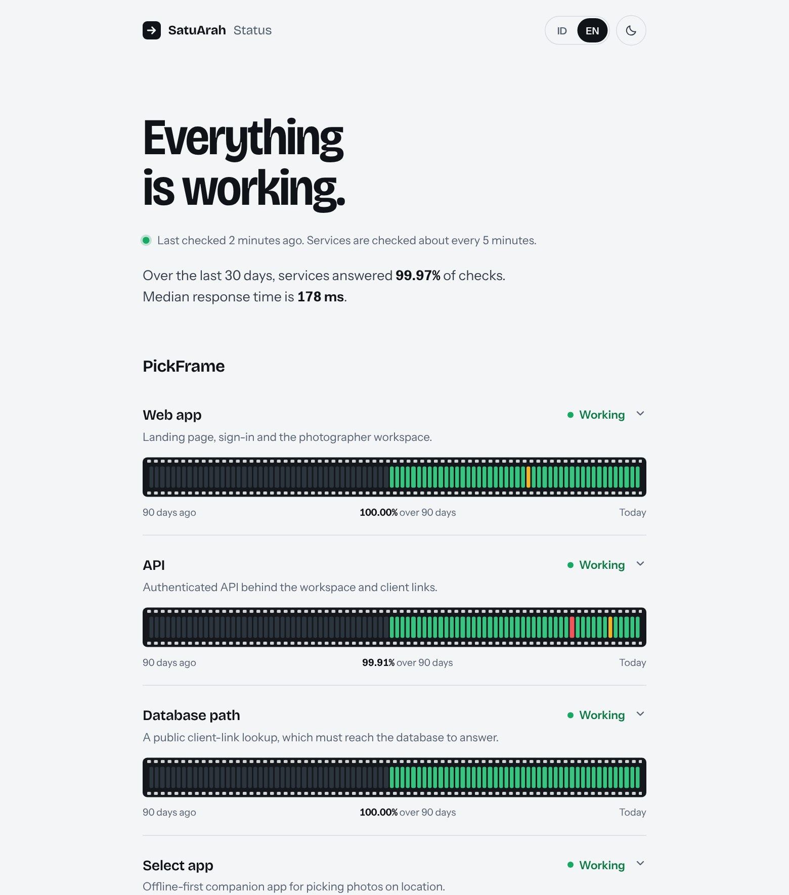
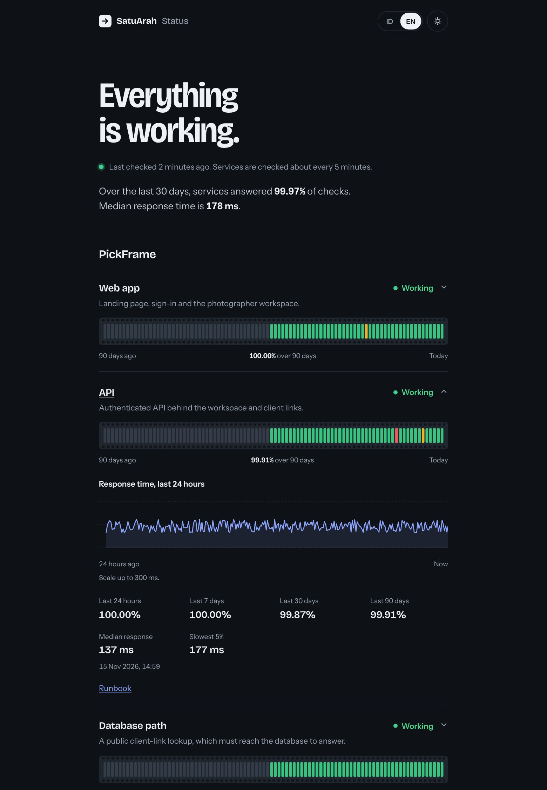
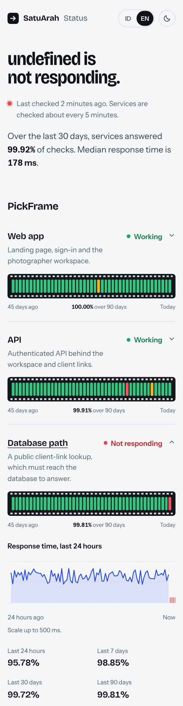
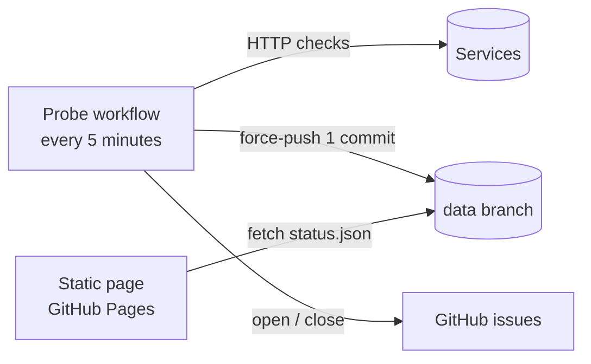

# satuarah-status

[](https://github.com/indraaryaLabs/satuarah-status/actions/workflows/ci.yml)
[](https://github.com/indraaryaLabs/satuarah-status/actions/workflows/probe.yml)
[](LICENSE)

A status page and uptime monitor for the products I run under SatuArah, built with no server and no bill. A scheduled GitHub Actions job checks each service, a branch stores the history, and a static page shows it.

**Live page:** https://indraaryalabs.github.io/satuarah-status/



## What it does

- Checks five production endpoints every 5 minutes (15 for the database path) with status, content and latency assertions.
- Shows 90 days of history per service, 24 hour response time charts, availability for 24 hours, 7, 30 and 90 days, and past incidents.
- Opens a GitHub issue when a service is confirmed down or slow, and closes it on recovery, so the owner gets an email without any extra service.
- Says so when it cannot tell: an old data warning, an unreachable data state, and an honest "no data yet" for days before monitoring began.
- Works in Indonesian and English, in light and dark, from 320 pixels up, with keyboard and screen reader support.

| Dark theme, details open                                                                                               | Incident on a phone                                                                                                |
| ---------------------------------------------------------------------------------------------------------------------- | ------------------------------------------------------------------------------------------------------------------ |
|  |  |

## How it works



The design choices that matter, each written up as an ADR:

- [GitHub Actions is the monitor](docs/adr/0001-github-actions-as-the-monitor.md). Free, no server that can sleep. The cost is that scheduled runs can start late, which the page makes visible.
- [The data branch always has one commit](docs/adr/0002-single-commit-data-branch.md). Five-minute commits would bury the real history.
- [The page is static and reads one JSON file](docs/adr/0003-static-page-reads-published-json.md). Deploying the page and updating the data are independent.
- [Failures are smoothed, but counted honestly](docs/adr/0004-smoothing-and-availability-rules.md). One retry inside a run, two bad checks to confirm, incidents start at the first failure, availability is floored so it never shows 100.00% with a failure in it.

More detail in [docs/architecture.md](docs/architecture.md).

## What is monitored

| Service                 | Check                                                                                                 |
| ----------------------- | ----------------------------------------------------------------------------------------------------- |
| PickFrame web app       | `200` and the app shell marker                                                                        |
| PickFrame API           | `200` and a healthy JSON body                                                                         |
| PickFrame database path | `404` and "not found" for an unknown client link, which can only be answered by querying the database |
| PickFrame Select app    | `200` and the product name                                                                            |
| Portfolio               | `200` and the owner's name                                                                            |

Objectives and error budgets are in [docs/slo.md](docs/slo.md). What to do when each one fails is in [docs/runbooks](docs/runbooks/README.md).

## Design

The page is built around the thing PickFrame is for: photographs. Each day is a frame on a strip of film, lit green when every check passed, amber or red when some did not, and dark when nothing was measured. The strips "develop" left to right once when the data first loads, and never again.

Around that, the page stays plain: sentences instead of stat tiles, no cards, one hairline between rows, Bricolage Grotesque for headings and Instrument Sans for text, and a single ink-blue accent. Colour is never the only signal: every state also has a word.

## Run it

Requires Node.js 22.18 or newer.

```bash
npm ci
npm run dev        # the page, reading the published data
npm test           # unit and integration tests for the monitor
npm run test:e2e   # browser tests and accessibility audit
npm run verify     # typecheck, lint, format, unit tests
```

Run a probe on your machine (writes to a folder, opens no issues):

```bash
node monitor/cli.ts --data /tmp/status --force
```

Set `PW_CHANNEL=chrome` to use an installed Chrome for the browser tests.

## Use it for your own services

1. Fork the repository and edit [`config/services.json`](config/services.json).
2. In Settings, Pages, choose GitHub Actions as the source.
3. Run the Probe workflow once. It creates the `data` branch.
4. Set `site.repository` in the config, and `VITE_REPOSITORY` when building the page, if your fork has a different name.

Each service takes:

| Field                                    | Meaning                                                      |
| ---------------------------------------- | ------------------------------------------------------------ |
| `id`, `group`, `name`, `description`     | Identity and display text                                    |
| `url`                                    | What to request                                              |
| `expect.status`                          | Accepted status codes                                        |
| `expect.bodyIncludes`                    | Text the response must contain                               |
| `intervalSec`, `timeoutMs`, `degradedMs` | Per-service overrides of the defaults                        |
| `href`                                   | Link shown on the page                                       |
| `runbook`                                | Repository path, linked from incidents and the page          |
| `label`, `translations.id`               | Names and descriptions for sentences and the Indonesian page |

Invalid configuration fails the run with a message that names the field.

## Tests

- **64 unit and integration tests** for the monitor: config validation, the check module against a local HTTP server (success, 5xx, wrong content, slow, hanging, refused, redirect, retry), the state machine (blips, confirmation, escalation, recovery, pruning), availability maths, the published document, and notifications against a fake GitHub.
- **29 browser tests** with fixtures produced by the same state machine, covering normal, slow, outage, first-run, stale and failed-load states; keyboard use of the day strips; language and theme persistence; reduced motion; a 320 pixel layout; and an axe-core WCAG 2.2 AA audit of five states in both themes.

## Limits

- Scheduled workflows can start late, and GitHub disables them after 60 days without repository activity. The page warns when its data is old; the [monitor runbook](docs/runbooks/monitor-pipeline.md) covers re-enabling.
- Every check comes from one place, so latency describes how fast a service answers from there.
- Detection takes up to two check intervals by design.
- It sees only what an anonymous HTTP request can see.

## Layout

```
config/services.json   what to watch
monitor/               checks, state machine, publisher, notifier, CLI, tests
shared/types.ts        the contract between monitor and page
site/                  the static page
e2e/                   browser tests and fixtures
docs/                  architecture, SLOs, ADRs, runbooks, postmortem template
.github/workflows/     CI, Probe, Pages
```

## License

[MIT](LICENSE)
