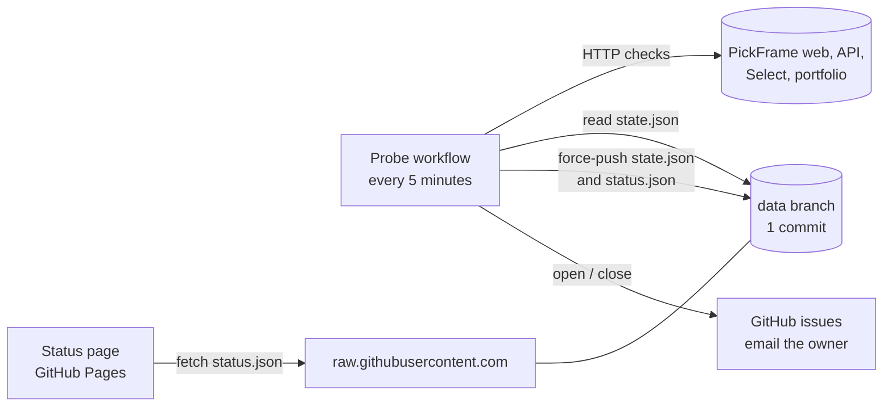

# Architecture

The system has no server. A scheduled GitHub Actions job measures, a branch stores, and a static page reads.

## Components

| Part          | Where                | Job                                                                                             |
| ------------- | -------------------- | ----------------------------------------------------------------------------------------------- |
| Check         | `monitor/check.ts`   | One HTTP request with timeout, status and content assertions, plus one retry inside the run     |
| State machine | `monitor/state.ts`   | Smooths observations into a published level, keeps daily counters, opens and resolves incidents |
| Publisher     | `monitor/publish.ts` | Turns state into the 90 day document the page reads                                             |
| Notifier      | `monitor/notify.ts`  | Mirrors incident transitions into GitHub issues                                                 |
| CLI           | `monitor/cli.ts`     | One run: load state, check what is due, apply, notify, write                                    |
| Page          | `site/`              | Static Vite app, no framework, renders `status.json`                                            |
| Contract      | `shared/types.ts`    | Types both sides import; the only coupling between them                                         |

## Data

`state.json` is private working state: per service, a streak counter pair, the last observation, per-day counters for 100 days, 24 hours of raw samples, plus the incident list.

`status.json` is derived from it on every run and is the only thing the page reads: 90 day tiles per service, availability windows (24 hours, 7, 30, 90 days), p50 and p95 latency, and incidents of the last 90 days.

Both files are small (about 15 KB for five services) and rewritten completely each run.

## Run, step by step

1. Fetch `state.json` from the `data` branch, or start empty.
2. Check every service that is due. A service has its own `intervalSec`, so the database path is probed every 15 minutes while the rest run every 5. A 45 second tolerance absorbs cron jitter.
3. Retry once after two seconds when an attempt fails. The first attempt that is not down wins.
4. Fold each observation into the state. A bad streak of two observations confirms a failure and opens an incident; the first healthy observation resolves it.
5. Notify: create, escalate or close the matching GitHub issue.
6. Write both files, replace the `data` branch with a single new commit.

## Failure modes

| What breaks                         | What visitors see                                                                              | Why it is acceptable                                                                                                     |
| ----------------------------------- | ---------------------------------------------------------------------------------------------- | ------------------------------------------------------------------------------------------------------------------------ |
| Actions skips or delays runs        | Page shows a "data is N minutes old" notice after 15 minutes                                   | Honest, and stated on the page itself                                                                                    |
| `raw.githubusercontent.com` is down | "Status data could not be loaded", with a line saying this does not mean the services are down | The page never guesses                                                                                                   |
| `state.json` is corrupt             | Probe run fails loudly, the page goes stale                                                    | Starting over silently would erase history, so it stops instead. See the [monitor runbook](runbooks/monitor-pipeline.md) |
| A notification call fails           | Nothing; the page is unaffected                                                                | The monitor logs it and continues                                                                                        |
| Repository is idle for 60 days      | Scheduled runs are disabled by GitHub                                                          | Known limit, see the runbook for the one-click fix                                                                       |
